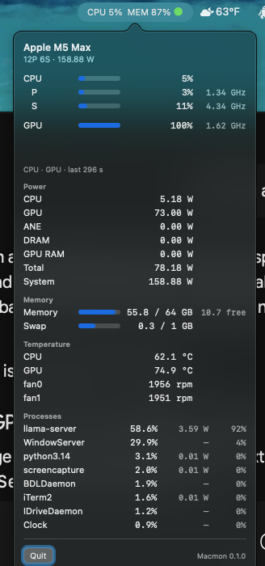

# `macmon` — a menu bar monitor for Apple Silicon

<div align="center">

[](LICENSE)

</div>

This is my fork of [`vladkens/macmon`](https://github.com/vladkens/macmon), the sudoless Apple Silicon
monitor. Everything upstream has — the terminal UI, `pipe`, `serve`, `stress`, `find-clpc`, and the Rust
library — is here and unchanged. What this fork adds is a **native macOS menu bar app** on the same
sampler: a status item and a panel, with no sudo, no privileged helper and no daemon.

[FORK.md](FORK.md) covers what diverges from upstream, why, and how the two are kept in step.

<div align="center">
  
</div>

## 🖥️ The app

A status item reading `CPU 5%  MEM 87%` and a dot — green, yellow or red — with a panel behind a left
click. It shows the same numbers the terminal UI shows, from the same sampler, so the app, the TUI,
`pipe` and `serve` cannot disagree.

- **CPU** — combined usage, then a row per core type (`P`, `S`) with its frequency
- **GPU** — usage and frequency
- **History** — the last minute of CPU and GPU usage as a chart, with a gap where the machine stopped
  reporting (sleep, a closed lid) rather than a line across it
- **Power** — CPU, GPU, ANE, DRAM, GPU RAM, their total, and the machine's total system power
- **Memory** — used / total, what is still available, and swap
- **Temperature** — CPU and GPU in °C, and each fan in rpm
- **Processes** — the eight busiest, with CPU, power where the process reports it, and GPU usage

A right click opens the settings, `Quit macmon` among them. The panel states the SoC, its core layout and
its total power draw at the top, and the drawing follows the system appearance.

### Install

```sh
git clone https://github.com/rpmalouin/macmon && cd macmon
make macapp-install
```

That builds `dist/Macmon.app`, signs it ad-hoc, and copies it to `/Applications` (or `~/Applications`
when `/Applications` is not writable). Start it from there or from Spotlight.

Needs macOS 14 or newer, Xcode or the Command Line Tools with Swift 5.9, and a Rust toolchain. Nothing
here needs sudo, and the app installs no privileged helper.

To start it at login, use **Start at login** in the right-click menu: it writes a LaunchAgent at
`~/Library/LaunchAgents/com.ronmalouin.macmon.plist`, which runs the app at your next login. The agent
restarts the app if it dies badly and leaves a normal quit alone.

### The dot

The dot is the whole point of the status item, so it is judged on **memory pressure, not memory in use**:

| dot | means |
| --- | --- |
| 🟢 green | CPU at or below 75% **and** more than 10% of memory available |
| 🟡 yellow | CPU above 40%, or 10% or less of memory available |
| 🔴 red | CPU above 75%, or under 5% of memory available |

"Available" is free + inactive + purgeable + speculative memory: what the kernel can still hand out. The
number people usually mean by "memory used" (Activity Monitor's, and this app's `MEM` figure) includes
reclaimable `inactive` pages, so it sits at 87–92% on this machine — a 35 GB local model is resident —
while nothing is wrong. A dot keyed to that figure either fires constantly or flaps. This one reads
15–16% available with the model loaded, which is clear of the yellow line by design.

### Settings

Right-click the status item:

- **Update every** — 1, 2 or 5 seconds
- **Compact label** — `12%` instead of `CPU 12%  MEM 47%`
- **Show history**, **Show processes** — turn the panel's lower blocks off
- **Start at login**
- **Quit macmon**

Settings live in `UserDefaults`, deliberately not in `~/.config/macmon.json`: that file belongs to the
terminal UI, which drops any field it does not recognise when it saves.

### Build targets

```sh
make macapp            # build dist/Macmon.app, ad-hoc signed
make macapp-run        # build and open it
make macapp-test       # the app's Swift tests
make macapp-icon       # redraw the app icon
make macapp-install    # build, then copy it to /Applications
make macapp-uninstall  # remove the installed copy
```

The app is SwiftUI + AppKit in [`macos/`](macos), on the sampler behind the C ABI in [`ffi/`](ffi). The
sampling loop runs on its own thread and the panel draws the most recent sample; the app never blocks on
a read.

## 🚀 The rest of it (shared with upstream)

The command line is upstream's, unchanged. Run `macmon` for the terminal UI, and `macmon --help` for the
flags.

```sh
macmon                 # the interactive terminal UI; press ? in it for the keys
macmon pipe -s 10 -i 500 | jq    # newline-delimited JSON samples
macmon serve                     # HTTP: /json and /metrics for Prometheus
macmon serve --install           # the same, as a launchd agent on port 9090
macmon stress cpu --duration 30  # generate load while watching the numbers
macmon find-clpc                 # find the CLPC power counters under CPU/GPU/ANE load
macmon debug                     # print what the sampler read and what it made of it
```

Two endpoints from `serve`:

| Endpoint       | Format     | Description                                                       |
| -------------- | ---------- | ----------------------------------------------------------------- |
| `GET /json`    | JSON       | Current metrics snapshot (same format as `pipe --soc-info`)        |
| `GET /metrics` | Prometheus | Metrics in [Prometheus text format][prom]                          |

[prom]: https://prometheus.io/docs/instrumenting/exposition_formats/

See [`examples/grafana`](examples/grafana) for a local Prometheus and Grafana demo stack.

Upstream also publishes this CLI as a package, without the app: `brew install macmon`,
`cargo install macmon`, `sudo port install macmon`, or `nix-env -i macmon`. Those install upstream's
release, so `macmon` will be on your `PATH` but there will be no menu bar app. Build this repository for
the app.

## 📊 Metrics

### Power sources and macOS 27

macOS 27 broke the CPU/ANE power source that macmon previously used without root. The IOReport
`Energy Model` counters can remain visible but stop updating: refreshing them now requires the private
`com.apple.private.pmgr.nrg.reporting` entitlement. Apple's signed `powermetrics` has this entitlement
and can keep using the named channels. Running macmon with `sudo` does not grant the same access.

The working rootless workaround we found is to read hidden energy reports from the AppleCLPC driver
through IOReport. These reports use opaque IDs instead of discoverable CPU/GPU/ANE channel names, so
macmon has to identify the counters and verify their units. This leaves macmon maintaining undocumented
mappings for data that Apple's own tool can still read directly.

Both the CLI and the Rust library use known CLPC counters automatically, and `Sampler::new()` retains
legacy fallbacks for older systems. New chips or driver versions may need additional mappings. On an
unsupported configuration, zero CPU/ANE readings can mean unavailable counters rather than zero
consumption. See [docs/clpc-discovery.md](docs/clpc-discovery.md) for details.

### Output format

The `pipe` command, the HTTP `/json` endpoint, and the app share the same metric names — the app reads
them through the C ABI of [`ffi/`](ffi) rather than parsing JSON.

<details>
<summary>JSON example</summary>

```jsonc
{
  "timestamp": "2025-02-24T20:38:15.427569+00:00",
  "temp": {
    "cpu_temp_avg": 43.73614, // Celsius, null when no sensor has a valid reading
    "gpu_temp_avg": 36.95167, // Celsius, null when no sensor has a valid reading
  },
  "memory": {
    "ram_total": 25769803776, // Bytes
    "ram_usage": 20985479168, // Bytes, as Activity Monitor counts it: includes reclaimable pages
    "ram_available": 6871947673, // Bytes the kernel can still hand out: free + inactive + purgeable + speculative, the pressure figure
    "swap_total": 4294967296, // Bytes
    "swap_usage": 2602434560, // Bytes
  },
  "fans": [
    { "name": "fan0", "rpm": 999, "max_rpm": 4900 },
    { "name": "fan1", "rpm": 1200, "max_rpm": 5200 },
  ],
  "cpu_scaled_ratio": 0.036854, // Combined frequency-scaled CPU ratio (weighted by core count, 0–1)
  "cpu_active_ratio": 0.092, // Combined active residency ratio (not frequency-scaled, weighted by core count, 0–1)
  "cpu_tiers": [ // CPU core types from the lowest to the highest: E, P on M1–M4; E, S on M5; P, S on M5 Pro/Max; E, P, S on M6; _ when the core type is unknown, e.g. the single tier of a macOS VM
    {
      "label": "E",
      "freq_mhz": 1100, // Tier frequency
      "scaled_ratio": 0.082656614, // Frequency-scaled ratio (0–1)
      "active_ratio": 0.18, // Active residency (not frequency-scaled, 0–1)
      "cores": [
        { "die_id": 0, "core_id": 0, "freq_mhz": 1600, "scaled_ratio": 0.14, "active_ratio": 0.24 },
        { "die_id": 0, "core_id": 1, "freq_mhz": 1700, "scaled_ratio": 0.12, "active_ratio": 0.2 },
      ],
    },
    {
      "label": "P",
      "freq_mhz": 1800,
      "scaled_ratio": 0.015181795,
      "active_ratio": 0.04,
      "cores": [
        { "die_id": 0, "core_id": 0, "freq_mhz": 2100, "scaled_ratio": 0.05, "active_ratio": 0.08 },
        { "die_id": 0, "core_id": 1, "freq_mhz": 2200, "scaled_ratio": 0.07, "active_ratio": 0.06 },
      ],
    },
  ],
  // Deprecated, use cpu_tiers: ecpu_* is the lowest tier, pcpu_* the highest
  "ecpu_freq_mhz": 1100,
  "ecpu_scaled_ratio": 0.082656614,
  "ecpu_active_ratio": 0.18,
  "pcpu_freq_mhz": 1800,
  "pcpu_scaled_ratio": 0.015181795,
  "pcpu_active_ratio": 0.04,
  "ecpu_cores": [/* cores of the first tier */],
  "pcpu_cores": [/* cores of the last tier */],
  // Deprecated v0.7 aliases, kept for consumers that predate cpu_tiers
  "cpu_usage_pct": 0.036854, // cpu_scaled_ratio
  "ecpu_usage": [1100, 0.082656614], // [ecpu_freq_mhz, ecpu_scaled_ratio]
  "pcpu_usage": [1800, 0.015181795], // [pcpu_freq_mhz, pcpu_scaled_ratio]
  "gpu_usage": [461, 0.021497859], // [gpu_freq_mhz, gpu_scaled_ratio]
  "gpu_freq_mhz": 461, // GPU frequency
  "gpu_scaled_ratio": 0.021497859, // Frequency-scaled ratio (0–1)
  "gpu_active_ratio": 0.09, // GPU active residency ratio (not frequency-scaled, 0–1)
  "cpu_power": 0.20486385, // Watts
  "gpu_power": 0.017451683, // Watts
  "ane_power": 0.0, // Watts
  "all_power": 0.22231553, // Watts
  "sys_power": 5.876533, // Watts
  "ram_power": 0.11635789, // Watts
  "gpu_ram_power": 0.0009615385, // GPU SRAM power, Watts
}
```

</details>

`ram_available` is the fork's one addition to the format. It is additive: consumers that do not know the
field are unaffected, and `ram_usage` keeps its meaning. The rest of the key set, deprecated aliases
included, is upstream's and unchanged.

### Active and scaled ratios

`active_ratio` is the share of the sampling interval during which the processor was doing any work. `scaled_ratio` is the same measure adjusted for operating frequency, showing the share of the processor's maximum possible capacity that was used.

For interval $T$, $t_i$ is the time spent doing work at frequency $f_i$, and $f_\text{max}$ is the hardware maximum frequency for the CPU cluster or GPU. The product $T f_\text{max}$ is the theoretical maximum frequency-time the processor could deliver at full load without thermal or power throttling:

```math
R_\text{active} = \frac{\sum_i t_i}{T}
\qquad
R_\text{scaled} = \frac{\sum_i t_i f_i}{T f_\text{max}}
```

CPU ratios are calculated per core and averaged across the cluster. A core that did no work contributes zero; combined CPU ratios average all cores from all clusters:

```math
R_\text{cluster} = \frac{1}{N_\text{cores}}\sum_j R_j
```

Examples:

- Full interval at half the maximum frequency → `active = 1.0`, `scaled = 0.5`.
- Half the interval at the maximum frequency → `active = 0.5`, `scaled = 0.5`.
- One of ten cores working at maximum frequency → cluster `active = scaled = 0.1`.

## 📚 Library usage

`macmon` can be used as a Rust library to collect Apple Silicon metrics in your own applications.

Add it to your project:

```sh
cargo add macmon --no-default-features
```

The default `app` feature enables the `macmon` executable and its terminal UI dependencies. Disable default features when using `macmon` only as a library.

Run the [demo example](examples/demo.rs) from this repository:

```sh
cargo run --example demo
```

Then use the `Sampler` to collect metrics:

```rust
use macmon::Sampler;

fn main() -> Result<(), Box<dyn std::error::Error>> {
    let mut sampler = Sampler::new()?;

    // collect metrics over a 1000ms window
    let metrics = sampler.get_metrics(1000)?;

    println!("CPU power:  {:.2} W", metrics.cpu_power);
    println!("GPU power:  {:.2} W", metrics.gpu_power);
    match metrics.temp.cpu_temp_avg {
        Some(value) => println!("CPU temp:   {value:.1} °C"),
        None => println!("CPU temp:   N/A"),
    }
    println!("RAM usage:  {} / {} bytes", metrics.memory.ram_usage, metrics.memory.ram_total);
    println!("RAM free:   {} bytes", metrics.memory.ram_available);
    for tier in &metrics.cpu_tiers {
        println!("{}-CPU:      {} MHz  {:.1}%", tier.label, tier.freq_mhz, tier.scaled_ratio * 100.0);
    }

    Ok(())
}
```

`get_metrics(duration_ms)` blocks the calling thread while collecting one IOReport delta over the complete interval. For a UI, server, or async application, create the sampler inside a dedicated worker thread and send the completed metrics back through a channel:

```rust
use std::{sync::mpsc, thread};

use macmon::Sampler;

fn main() -> Result<(), Box<dyn std::error::Error>> {
    let (tx, rx) = mpsc::channel();

    thread::spawn(move || {
        let mut sampler = Sampler::new().expect("failed to create sampler");

        while let Ok(metrics) = sampler.get_metrics(1000) {
            if tx.send(metrics).is_err() {
                break;
            }
        }
    });

    // Use recv() in a consumer thread or try_recv() in a non-blocking event loop.
    let metrics = rx.recv()?;
    println!("CPU power: {:.2} W", metrics.cpu_power);

    Ok(())
}
```

Creating `Sampler` inside the worker keeps its low-level macOS handles on that thread. In an async runtime, use its blocking-thread facility rather than calling `get_metrics` directly from an executor worker.

The same sampler is available to non-Rust UIs through the C ABI in [`ffi/`](ffi), which returns each
sample as JSON. That is the seam the app uses, and it keeps the ABI stable while the metrics grow.

## 🤝 Contributing

Upstream takes issues and pull requests: see [`vladkens/macmon`](https://github.com/vladkens/macmon).
This fork is developed for one Mac and commits straight to `main`; see [FORK.md](FORK.md).

## 📝 License

Distributed under the [MIT License](LICENSE), as upstream, and the same terms cover this fork's changes.

## 🔍 See also

- [tlkh/asitop](https://github.com/tlkh/asitop) – The original tool. Written in Python, requires sudo.
- [dehydratedpotato/socpowerbud](https://github.com/dehydratedpotato/socpowerbud) – Written in Objective-C, sudoless, no TUI.
- [op06072/NeoAsitop](https://github.com/op06072/NeoAsitop) – Written in Swift, sudoless.
- [graelo/pumas](https://github.com/graelo/pumas) – Written in Rust, requires sudo.
- [context-labs/mactop](https://github.com/context-labs/mactop) – Written in Go, requires sudo.
- [exelban/stats](https://github.com/exelban/stats) – A menu bar monitor with many more sensors, and a
  different design: macmon's app is a panel on this sampler, so it shows the same power figures the CLI does.
